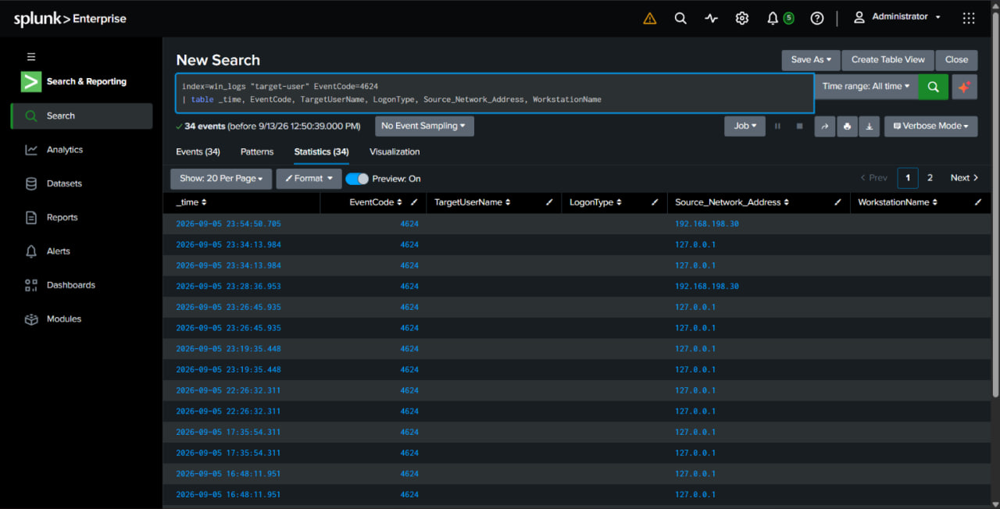
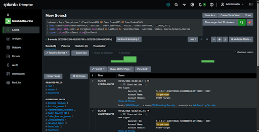

# Centralized SIEM & Log Monitoring Lab (Splunk Enterprise)

## Project Overview
This project demonstrates the deployment and configuration of an enterprise-grade Security Information and Event Management (SIEM) solution using Splunk Enterprise. The primary objective is to build a centralized log analysis, threat detection, and real-time monitoring system across heterogeneous environments (Windows & Linux endpoints).

---

## Architecture & Topology
- SIEM Manager / Server: Splunk Enterprise running on Ubuntu Server.
- Log Collectors / Agents: 
  - Windows Server 2022 (Active Directory Domain Controller logs)
  - Ubuntu Linux Server (Syslog & Auth logs)
- Monitoring & Visualization: Splunk Web Dashboard for real-time alert analysis and threat detection.

---

## Key Technologies & Tools
* SIEM Tools: Splunk Enterprise, Splunk Forwarder
* Operating Systems: Windows Server 2022, Ubuntu 22.04 LTS, VMware ESXi / Workstation
* Protocols & Log Types: Syslog, Windows Event Logs (Security, System, Application), Sysmon
* Analysis & Response: SPL (Splunk Processing Language), Custom Alert generation, Incident Detection

---

## Key Implementations & Highlights

### 1. Forwarder Deployment & Centralized Ingestion
- Installed and configured Splunk Universal Forwarders on Windows and Linux endpoints.
- Configured log forwarding rules to stream real-time events to the central Splunk Enterprise instance.
- Integrated Sysmon on Windows endpoints to capture detailed process creation, network connections, and driver loading.

### 2. Detection Rules & Log Analysis
- Customized SPL queries to identify critical security events, including:
  - Brute-force authentication attempts (RDP / SSH)
  - Privilege escalation and user group modifications
  - Windows Event ID 4624 (Successful Logons) tracking
- Filtered false positives to optimize security analyst workflows.

### 3. Threat Visualization & Incident Response
- Created custom dashboards for real-time security posture monitoring.
- Analyzed event logs to simulate incident response for common attack vectors.

---

## Lab Screenshots & Proof of Concept

### 1. Splunk SPL Query for Windows Authentication Analysis
Querying Event ID 4624 (Successful Logon) and displaying structured target users, logon types, and source IP addresses:

### 2. Event Log Analysis & Status Categorization
Detailed security event log inspection categorizing authentication states across endpoints:

---

## Key Takeaways & Skills Learned
* Practical experience with real-time log ingestion and security event correlation using Splunk.
* Proficiency in SPL (Splunk Processing Language) and event log parsing.
* Strong understanding of Windows Event Logs, Sysmon, and Linux Syslog formats.
* Incident investigation and log-based threat hunting fundamentals.
